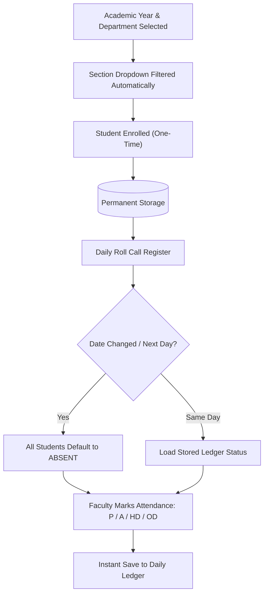
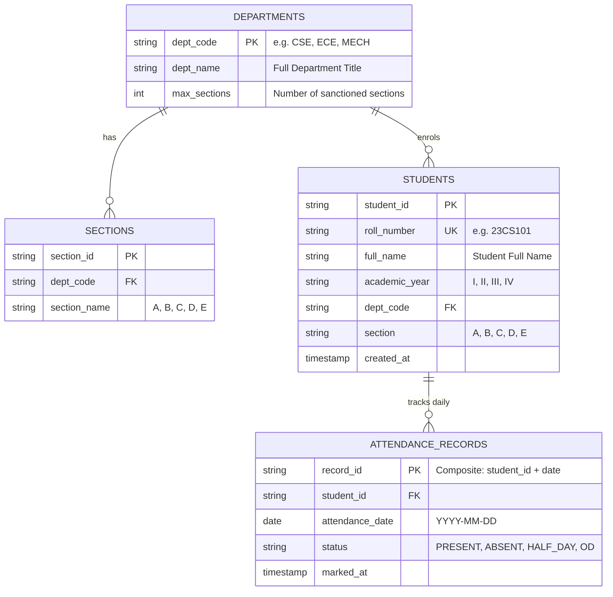

# Muthayammal Engineering College (Autonomous)
## Student Attendance Management System - Idea, Architecture & Specification

---

## 1. Project Overview & Vision

The **MEC Student Attendance Management System** is a purpose-built, high-reliability academic attendance solution designed specifically for departmental faculty and class advisors at **Muthayammal Engineering College (Autonomous)**.

Unlike corporate employee punch-clock systems that require continuous biometric check-in/check-out timestamps and complex hours tracking, this system focuses on **academic roll-call workflows**:
1. **One-Time Permanent Student Registry**: Students are enrolled once with their Full Name, Roll / Register Number, Academic Year, Department, and Section. Faculty never have to re-enter student details again.
2. **Dynamic Department & Section Mapping**: The system automatically restricts and renders only the valid sections applicable to each specific department (e.g., CSE Sections A through E; single sections for specialized programs).
3. **Next-Day Automatic Default ABSENT**: When transitioning to a new date, all students automatically default to `ABSENT`. Faculty need only mark the attendees (`P`, `HD`, or `OD`), drastically reducing attendance entry time.
4. **Data Integrity & Non-Destructive Design**: Once enrolled, students cannot be arbitrarily removed during roll call (Remove option eliminated), preventing accidental record loss.
5. **Clean Institutional UX**: Formal typography and branding featuring the official Muthayammal Engineering College logo with zero emojis or non-standard icons.

---

## 2. Core Business Logic & Workflow Architecture



### 2.1 Department & Section Configuration Matrix

| Department Code | Department Name | Allowed Sections | Total Sections |
| :--- | :--- | :---: | :---: |
| `CSE` | Computer Science and Engineering | **A, B, C, D, E** | 5 |
| `MECH` | Mechanical Engineering | **A, B, C** | 3 |
| `EEE` | Electrical and Electronics Engineering | **A, B, C, D** | 4 |
| `BIO-TECH` | Biotechnology | **A** | 1 |
| `CSE [CYBER SECURITY]` | CSE (Cyber Security) | **A** | 1 |
| `CSE [AI&ML]` | CSE (Artificial Intelligence & Machine Learning) | **A** | 1 |
| `CSE [CSBS]` | Computer Science & Business Systems | **A** | 1 |
| `CSE [VLSI]` | CSE (VLSI Design) | **A** | 1 |
| `ECE` | Electronics and Communication Engineering | **A, B, C, D** | 4 |
| `IT` | Information Technology | **A, B, C, D** | 4 |

### 2.2 Academic Year Options
Students are classified into four undergraduate academic years:
- **I Year** (First Year)
- **II Year** (Second Year)
- **III Year** (Third Year)
- **IV Year** (Final Year)

### 2.3 Attendance Status Taxonomy

| Code | Status Title | Academic Meaning | Default Behavior |
| :---: | :--- | :--- | :--- |
| **`P`** | `PRESENT` | Full-day class attendance recorded | Manually marked or set via 'All Present' |
| **`A`** | `ABSENT` | Student absent from class | **Automatic default for any new date** |
| **`HD`** | `HALF DAY` | Attended morning or afternoon session only | 0.5-day credit |
| **`OD`** | `ON DUTY` | Official college, sports, symposium, or project duty | Full academic attendance credit |

---

## 3. Database Architecture & Relational Schema

### 3.1 Entity-Relationship (ER) Diagram



### 3.2 SQL DDL Schema

```sql
-- 1. Students Table (Permanent Registry)
CREATE TABLE IF NOT EXISTS students (
    student_id VARCHAR(50) PRIMARY KEY,
    roll_number VARCHAR(30) NOT NULL UNIQUE,
    full_name VARCHAR(100) NOT NULL,
    academic_year VARCHAR(10) NOT NULL, -- 'I', 'II', 'III', 'IV'
    dept_code VARCHAR(30) NOT NULL,     -- 'CSE', 'MECH', etc.
    section VARCHAR(5) NOT NULL,        -- 'A', 'B', 'C', 'D', 'E'
    is_active BOOLEAN NOT NULL DEFAULT TRUE,
    created_at TIMESTAMP DEFAULT CURRENT_TIMESTAMP
);

-- 2. Daily Attendance Ledger Table
CREATE TABLE IF NOT EXISTS attendance_records (
    record_id VARCHAR(100) PRIMARY KEY, -- e.g. 'stud_23CS101_2026-10-18'
    student_id VARCHAR(50) NOT NULL REFERENCES students(student_id) ON DELETE CASCADE,
    attendance_date DATE NOT NULL,
    status VARCHAR(20) NOT NULL DEFAULT 'ABSENT', -- Default ABSENT on new dates
    updated_at TIMESTAMP DEFAULT CURRENT_TIMESTAMP,
    CONSTRAINT uq_student_daily_attendance UNIQUE (student_id, attendance_date)
);

-- Performance Indexes
CREATE INDEX IF NOT EXISTS idx_students_dept_year_sec ON students(dept_code, academic_year, section);
CREATE INDEX IF NOT EXISTS idx_attendance_date ON attendance_records(attendance_date);
CREATE INDEX IF NOT EXISTS idx_attendance_student_date ON attendance_records(student_id, attendance_date);
```

---

## 4. Key Architectural Decisions

1. **Elimination of Entry/Exit Timestamps**: Corporate clock-in/clock-out systems introduce friction and inaccuracy in classroom settings. Academic attendance is transactional per class session or day, properly represented by distinct status codes (`P`, `A`, `HD`, `OD`).
2. **Elimination of Destructive Student Deletion in Roll Call**: Faculty should never risk accidentally deleting a student's permanent academic record while taking daily roll call. The removal option was purposely removed.
3. **Client-Side & Server-Side Persistence Synergy**: 
   - Uses web `localStorage` key names (`mec_permanent_students_registry_v3` and `mec_permanent_attendance_ledger_v3`) for zero-latency, offline-capable browser operation.
   - Synchronizable directly with the underlying SQLite database (`attendance.db`).
4. **Instant Dynamic Filtering**:
   - Selecting `Year` (e.g., II Year), `Dept` (e.g., CSE), and `Section` (e.g., B) instantaneously filters the roster in $O(N)$ client-side execution time without page reloads.
